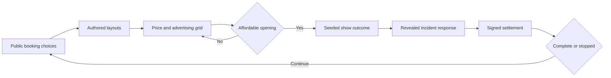

# Front of House balance workbench

Compare reproducible player policies through the existing rules engine before
changing balance. The workbench has no browser, renderer, service or dependency.
It never modifies game rules, tuning values, saves or existing balance baselines.

## Run and replay

From the repository root:

```sh
npm run test:front-of-house-workbench
npm run sim:front-of-house-workbench -- --seeds 100 --start 1 --shows 60
npm run sim:front-of-house-workbench -- --replay front-of-house/sim/output/report.json
```

Use `--out` to select another output directory. The default ignored `sim/output`
directory receives `REPORT.md` for reading and `report.json` for analysis/replay.
The JSON contains source digests, every measured career's show decisions and
outcomes, and selected complete action traces with receipts. The replay command
refuses different source digests and verifies every example's final saved-state
hash. Reports omit timestamps and output paths so identical inputs produce
identical bytes. Each run replaces its selected output files; use a fresh `--out`
directory to retain a prior experiment.

The first 80 percent of seed IDs form the development cohort; the remaining
20 percent are held out. Freeze strategies before consulting held-out results.
Policy edits after viewing those results require a new seed range for a fresh
validation cohort. The cohorts are reproducible seeds, not a random sample of
human players. Failed invariants terminate the command rather than counting an
engine or harness error as a player loss.

## Policies

| Policy | Booking and promotion | Incident response |
| --- | --- | --- |
| Beginner | First affordable offered act/deal with suggested layout, usual price, reference advertising and direct Club sales | Cheapest affordable response |
| Cautious | Prefer an opening that preserves the largest authored incident fee; rank forecast profit with an opening-cost penalty and reserve bonus | Strongest authored affordable response, then lower cost |
| Growth | Forecast net plus conservative attendance, with a bonus for estimated passing satisfaction | Strongest authored affordable response |
| Aggressive | Favor optimistic ticket gross and larger acts, with a small opening-cost penalty | Strongest authored affordable response |
| Profit | Highest estimated net within the candidate grid | Strongest authored affordable response |
| Random legal | Uniform among affordable grid combinations using a separate reproducible choice generator | Uniform affordable response |

These are explicitly authored heuristics, not calibrated models of human skill.
Growth is a one-step progression heuristic, not a multishow optimal solver. Profit
optimizes an approximate public score, not actual future settlement. Aggressive
is an optimism control, not a claim that spending more is always rational. Random
weights combinations equally, so its distribution depends on grid construction.

The original six policies advance to the highest earned venue. Version 2 adds
four controls, keeping the original policies unchanged:

| Control | Change from original |
| --- | --- |
| beginner-adaptive | Keep the preferred beginner plan; when unavailable choose the cheapest affordable grid opening, with ID tie-break and original cheapest incident response |
| beginner-recovery | Try the original beginner plan at the highest earned room, then each smaller earned room if no preferred plan is affordable |
| beginner-adaptive-recovery | Apply adaptive booking first at the highest room, then at smaller earned rooms if no grid plan is affordable |
| random-recovery | Original random selection, then smaller earned rooms only if the highest room has no affordable grid plan |

Recovery returns to the highest earned room on the next booking, rather than
holding at the smaller room. It does not bypass the engine's done-phase
Next show refusal. Each actual downshift records the attempted rooms and cash;
all venue changes use legal actions. Random controls use the same choice seed
as their baseline until their paths diverge. Matched game seeds align the
initial conditions; different choices can produce different later public rosters
and outcomes, so they are not identical future shocks. No career receives injected
cash, unlocks, relationships or preview knowledge. Planner inputs contain public
offers/relationships, venue/cash, usual prices, authored layout properties,
opening quotes and attendance forecasts. Future draws and incidents stay in the
engine. The incident ID becomes available only at the response step. Tests vary
hidden seeds while holding the public roster fixed in every room.

## Decision graph and coverage



The driver enumerates legal Book, Build and Promote combinations, selects a
policy edge, opens doors, chooses a revealed incident response, and signs the
settlement through `applyAction`. Public quotes reuse the existing pure engine/accounting functions and cached
geometry. Tests compare the projections against the authoritative opening quotes
and forecasts in all rooms; every selected opening is also checked against actual
engine cash charged. The resulting cash, reputation and unlocks
feed the next booking. Actions are traced for exact replay; no parallel economic
model determines measured outcomes.

The initial grid uses suggested/budget Lot layouts, included house lights in
larger rooms, Festival touring support with/without two delay towers, all eligible
Festival side acts, three ticket levels around each act's usual price, no/reference/
heavy advertising and both Club ticketing plans. Sponsor ticket pricing remains
fixed by the engine. Refused bookings, unaffordable openings and invalid promotions
are counted. Distinct selected branches are counted in each career's coverage.

This is a bounded decision graph, not every possible game action. Arbitrary
placement, individual ad-channel sweeps, held-night schedules, research, purchases,
and live services are excluded. A grid failure does not prove that no legal game
strategy exists. A policy failure can occur even while other grid plans remain.

## Read the outcomes

Completion and room reach use all careers in that policy cohort as denominator.
Completion timing uses completed careers only and shows its sample count in JSON.
Room outcomes also report reached careers and signed shows separately. No shows
in a room produce null statistics, never a zero-profit fictional observation.

`cashDelta` is actual available-cash change from before opening to after signing.
`net` is the engine settlement's economic result; these are different measures.
Loss recovery means regaining pre-loss cash within three later signed shows.
Unrecovered losses with insufficient follow-up are censored. A no-plan stop is
reported separately from the engine refusing continuation. Neither proves a
bankruptcy rule fired. A show-limit stop is incomplete, not a win or a loss.

Final cash is measured at completion or stopping, so careers can have different
lengths. Paired final-cash differences describe matched seeds; they are not a
causal treatment effect or a fixed-time return. Festival plan scoring uses the
public gross range minus opening cost, not exact net, and other forecasts omit
some optional system effects. Measured results always use real signed receipts.

Investigate beginner traps, weak recovery, per-tier income jumps and consistently
selected deals before proposing a change. Use controlled matched-seed ablations
to distinguish a policy error from a rule problem. Keep proposed tuning values
out of the playable game until the findings are reviewed.


## Recovery study provenance

The original six-policy findings and compact baseline remain the October 23
version 1 experiment. To reproduce that exact report use its recorded source
bundle or commit f9731fa, rather than version 2's ten-policy default. The fresh
recovery study uses seeds 2001 through 2100, with 2081 through 2100 held out.
Policies were frozen before examining that cohort. See the recovery findings
for matched transitions, limitations and proposed Festival pacing targets.
